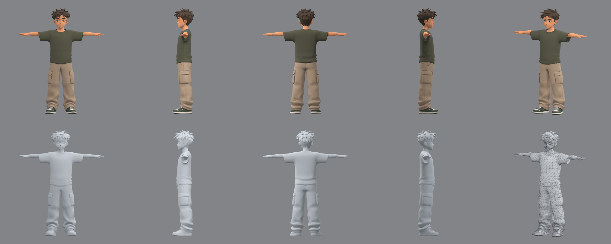

# The boy

The first character of Haras Valley: a boy of about four and a half head heights with spiky dark brown hair, hazel
eyes, a loose moss-green T-shirt, beige cargo trousers and green-and-white sneakers. He is a 3D model only for now:
no rig, no clips, no game code. The folder follows the first steps of the
[character pipeline](../../../../../README.md#making-a-character).



## Files

| File | Contents |
| --- | --- |
| `references/concept.png` | the standing concept, supplied with the request (image model not recorded) |
| `references/turnaround.png` | the T-pose turnaround the four views are cut from |
| `references/face-six-views.png` | the face from six angles, for later cleanup and facial work |
| `references/front.png`, `left.png`, `back.png`, `right.png` | the Tripo multiview set, one figure per sheet at one scale |
| `references/approval.json` | the review that let the set go to Tripo, with the hash of each view |
| `model-r03/job.json` | the Tripo task record: model P2, settings, credits, approval |
| `model-r03/raw/` | Tripo's outputs as downloaded: the textured FBX (quads, 4K PBR textures embedded) and its preview |
| `model-r03/review/` | the Blender review: `contact-sheet.png` (textured, clay and wireframe views), `turntable.gif`, `mesh-report.json`; the full-size renders are regenerated, not tracked |
| `../tools/review_model.py` | renders such a review for any downloaded model |

`model-r03/api-private/` (raw API responses, upload tokens), the turntable frames and the review `.blend` are ignored.

The mesh: one object, 8,527 polygons (6,679 quads), 15,206 triangles, one material with 4096² base colour,
roughness, metallic and normal maps, about 1 m tall in Tripo's units (he is scaled when rigged). Boundary and
non-manifold edges remain at the hair strands and the collar, as on Cairo's raw model.

## The side views

`left.png` shows his **left** side, so he faces image-left in it (the camera stands at +Y of a character facing +X);
`right.png` shows him facing image-right. Takes 1 and 2 had the two swapped, and Tripo grew a mirrored second face,
sculpted and painted, on the back of his head in both. The corrected set gave take 3 at the first try. The failed
takes and the Blender repair tried on the first one live in the archive, not here.

## How it was made

```sh
# cut the views from the turnaround and record the approval: see references/approval.json
python platform/studio/atelier/ai/tripo_asset.py generate --references games/haras_valley/assets/characters/boy/references \
    --output games/haras_valley/assets/characters/boy/model-r03 --faces 8000      # Tripo P2, multiview to 3D, 120 credits
/Applications/Blender.app/Contents/MacOS/Blender -b --python games/haras_valley/assets/characters/tools/review_model.py -- \
    --input games/haras_valley/assets/characters/boy/model-r03/raw/output_model_url.fbx \
    --output games/haras_valley/assets/characters/boy/model-r03/review
```

## Next

1. Clean the raw mesh in Blender where the review shows it (collar, sneaker soles, hair strand seams), as Cairo's step 3.
2. Rig: `tripo_asset.py rig` (25 credits) on the approved cleanup, then `add_tripo_fingers.py` for the hands, so the
   rig follows the [humanoid bone contract](../../../../../platform/conventions/rigs/humanoid.toml).
3. `character.toml`, and the game's `build.py` step that exports him for Unreal.
