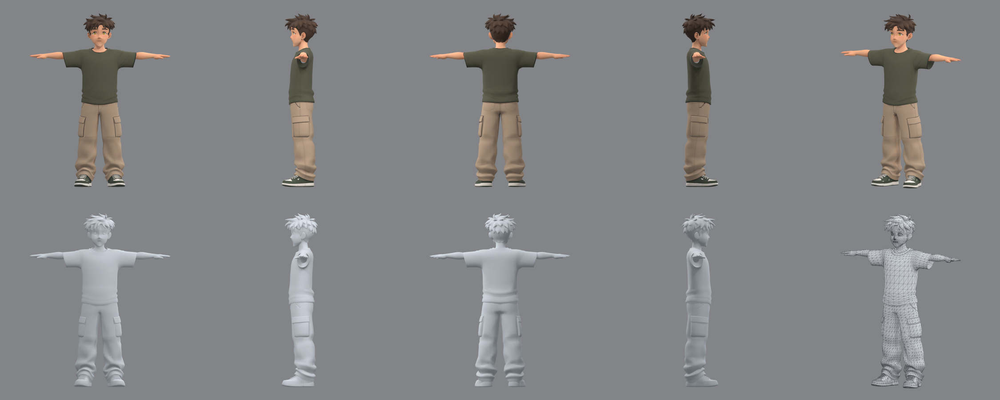
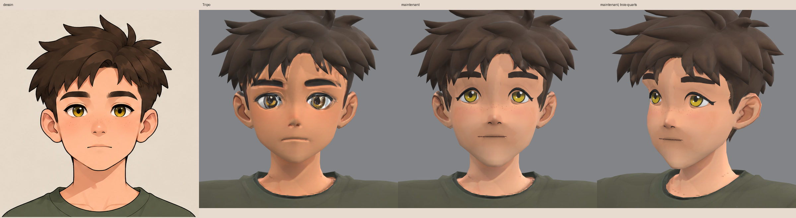

# The boy

The first character of Haras Valley: a boy of about four and a half head heights with spiky dark brown hair, hazel
eyes, a loose moss-green T-shirt, beige cargo trousers and green-and-white sneakers. He is a 3D model only for now:
no rig, no clips, no game code. The folder follows the first steps of the
[character pipeline](../../../../../README.md#making-a-character).





## Files

| File | Contents |
| --- | --- |
| `references/concept.png` | the standing concept, supplied with the request (image model not recorded) |
| `references/turnaround.png` | the T-pose turnaround the four views are cut from |
| `references/face-six-views.png` | the face from six angles, for later cleanup and facial work |
| `references/front.png`, `left.png`, `back.png`, `right.png` | the Tripo multiview set, one figure per sheet at one scale |
| `references/approval.json` | the review that let the set go to Tripo, with the hash of each view |
| `model-r03/job.json` | the Tripo task record: model P2, settings, credits, approval |
| `model-r03/raw/` | Tripo's outputs as downloaded: the textured FBX (quads, 4K PBR textures embedded) and its preview |
| `model-r03/review/` | the Blender review: `contact-sheet.png` (textured, clay and wireframe views), `turntable.gif`, `mesh-report.json`; the full-size renders are regenerated, not tracked |
| `cleanup-r01/` | the face, eyes and hair brought back to the sheets by `../tools/cleanup_face_hair.py` and `../tools/eyes.py`: `cleanup.json` (what moved), the review and the comparison sheets; the `.blend`, `.glb` and repainted texture maps are regenerated in two minutes, not tracked |
| `../tools/review_model.py` | renders such a review for any downloaded model |

`model-r03/api-private/` (raw API responses, upload tokens), the turntable frames and the review `.blend` are ignored.

The mesh: one object, 8,527 polygons (6,679 quads), 15,206 triangles, one material with 4096² base colour,
roughness, metallic and normal maps, about 1 m tall in Tripo's units (he is scaled when rigged). Boundary and
non-manifold edges remain at the hair strands and the collar, as on Cairo's raw model.

## The side views

`left.png` shows his **left** side, so he faces image-left in it (the camera stands at +Y of a character facing +X);
`right.png` shows him facing image-right. Takes 1 and 2 had the two swapped, and Tripo grew a mirrored second face,
sculpted and painted, on the back of his head in both. The corrected set gave take 3 at the first try. The failed
takes and the Blender repair tried on the first one live in the archive, not here.

## The face and hair cleanup

Tripo's take was older and tanner than the drawings, with eyes too big and drooping, a prominent nose, lips sculpted
apart from the drawn mouth and a V-shaped jaw. `cleanup_face_hair.py` fixes it in Blender, textures and vertices
only: the topology and UVs are Tripo's, less the brow strips and cornea discs.

- **Measured, not guessed.** The face sheet's front view is overlaid on a front render with the pupils made to
  coincide (the dark centres of the drawn irises; a first measure took a lash line for a pupil and overstated their
  spacing by 12%, which left the eyes too small and too far apart).
- **Shape first** (`face.py`, `eyes.py`, `mouth.py`). The jaw drops onto the drawing's rounder outline and the chin
  recedes 5 mm, as the drawing's profile runs straight from nose to chin; the eyes shrink to the drawing's size,
  move 2 mm toward the nose, turn 8 degrees outer corner up and open; the nose stands out 60% as far; the mouth rises
  3.3 mm; the sculpted lips are flattened and the area between nose, cheeks and chin smoothed into one surface and
  straightened into one slope, so no muzzle and no bump over the upper lip are left. The shading normals of every moved vertex are re-derived, since Tripo's FBX carries the
  sculpt's shading frozen. (Widening the cheeks to the drawing's measured width read as hamster cheeks; it is off.)
- **Then paint.** Tripo builds the head from separate pieces: hair cap, face with a hole at each eye, an eyeball
  behind each hole, brow strips, cornea discs. Clean cel eyes in the drawing's colours go on the eyeballs inside
  each hole's rim; thick straight brows, blush, freckles and one level mouth line are painted as drawn, placed from
  the painted pupils, and the nose (light tip, two arched nostrils, round shade) on the sculpted nose's tip. Skin and hair take the drawing's
  colours. Tripo's hair volume measures as the drawing's and is kept.

`compare-face.png` shows the sheet, Tripo's face, the cleaned face and its three-quarter; `overlay-drawing.png` the
drawing's lines over the cleaned face; `clay-views.png` the shape alone; `eyes-closeup-front.png`,
`nose-closeup.png` and `mouth-closeup-front.png` the details. `overlay_render.py` and `overlay_drawing.py` make the
overlay. `face_closeup.py`, `eye_closeup.py` and
`mouth_closeup.py` render them from a review blend. For a crisper source than the 512 px sheet cell,
`games/haras_valley/tools/face_portrait.py` paints a large front portrait with Sunburst (needs `OPENAI_API_KEY`).

## How it was made

```sh
# cut the views from the turnaround and record the approval: see references/approval.json
python platform/studio/atelier/ai/tripo_asset.py generate --references games/haras_valley/assets/characters/boy/references \
    --output games/haras_valley/assets/characters/boy/model-r03 --faces 8000      # Tripo P2, multiview to 3D, 120 credits
/Applications/Blender.app/Contents/MacOS/Blender -b --python games/haras_valley/assets/characters/tools/review_model.py -- \
    --input games/haras_valley/assets/characters/boy/model-r03/raw/output_model_url.fbx \
    --output games/haras_valley/assets/characters/boy/model-r03/review
/Applications/Blender.app/Contents/MacOS/Blender -b --python games/haras_valley/assets/characters/tools/cleanup_face_hair.py -- \
    --input games/haras_valley/assets/characters/boy/model-r03/raw/output_model_url.fbx \
    --references games/haras_valley/assets/characters/boy/references --output games/haras_valley/assets/characters/boy/cleanup-r01
/Applications/Blender.app/Contents/MacOS/Blender -b --python games/haras_valley/assets/characters/tools/face_closeup.py -- \
    games/haras_valley/assets/characters/boy/cleanup-r01/review/review.blend games/haras_valley/assets/characters/boy/cleanup-r01/review/face-closeup.png
```

## Next

1. Further mesh cleanup where the review shows it (collar, sneaker soles, hair strand seams), as Cairo's step 3.
2. Rig: `tripo_asset.py rig` (25 credits) on the approved cleanup, then `add_tripo_fingers.py` for the hands, so the
   rig follows the [humanoid bone contract](../../../../../platform/conventions/rigs/humanoid.toml).
3. `character.toml`, and the game's `build.py` step that exports him for Unreal.
