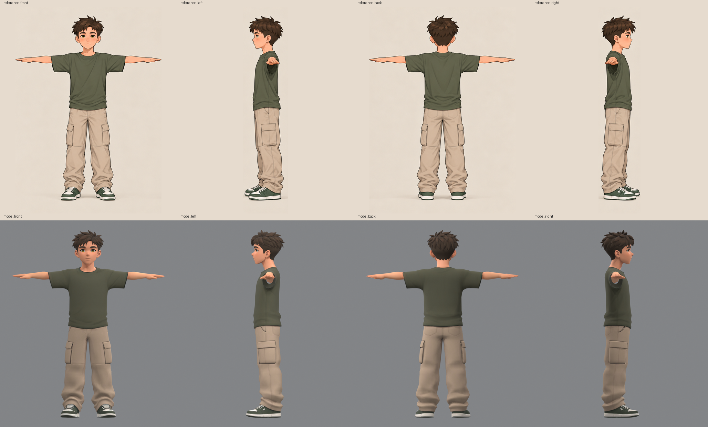
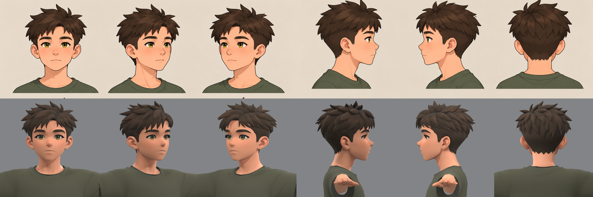

# The boy

The first character of Haras Valley: a boy of about four and a half head heights with spiky dark brown hair, hazel
eyes, a loose moss-green T-shirt, beige cargo trousers and green-and-white sneakers. He is the Garçon of the game's
character creation. The game is still a separate Unreal project outside this repository; it copies `graft-r01` and
fits it to its riders' skeleton itself (see *In the game*). The folder follows the first steps of the
[character pipeline](../../../../../README.md#making-a-character).

The current model is `graft-r01`: the body Tripo built from the full-figure turnaround (`model-r03`) with the head
Tripo built from the face sheet (`bust-r01`) in place of its own.





## Files

| File | Contents |
| --- | --- |
| `references/concept.png` | the standing concept, supplied with the request (image model not recorded) |
| `references/turnaround.png` | the T-pose turnaround the body's four views are cut from |
| `references/face-six-views.png` | the head from six angles: the source of the head's four views |
| `references/front.png`, `left.png`, `back.png`, `right.png`, `approval.json` | the body's Tripo multiview set and its review |
| `references-bust/front.png`, `left.png`, `back.png`, `right.png`, `approval.json` | the head's Tripo set, cut from the face sheet, and its review |
| `model-r03/` | the body's Tripo take: `job.json`, `raw/` (textured FBX and preview), `review/` |
| `bust-r01/` | the head's Tripo take: `job.json`, `raw/`, `review/` (its six views under the sheet's) |
| `graft-r01/` | the model: `graft.json` (scale, placement, skin gains) and `review/`; the `.blend`, `.glb` and recoloured textures are regenerated by `graft_bust.py` in a minute, not tracked |
| `../tools/graft_bust.py` | puts the bust on the body |
| `../tools/review_model.py`, `sheet_views.py`, `face_closeup.py` | the review renders |

The `api-private/` folders (raw API responses, upload tokens), turntable frames and review `.blend` files are
ignored.

## Why a separate head

The body came from the full-figure turnaround, where the head is about 150 px tall. Tripo read it as a generic face:
eyes to chin 1.27 pupil spacings against the drawing's 1.41, a flat eye line, a V-shaped jaw, a second face painted
over the sculpted features. A long series of Blender repairs (reshaping the eyes, nose, mouth and jaw, repainting the
face from the sheet) moved it closer but never made it read as the drawing; that revision is in git history and the
repair tools (`cleanup_face_hair.py`, `eyes.py`, `face.py`, `mouth.py`) remain beside `graft_bust.py`.

The face sheet draws the head at about 300 px, from the front, both profiles and the back. Cut at one scale with
the figures' tops aligned and each centred on the head's vertical axis (the ears, in profile), those four views gave
Tripo enough to build the head as drawn: eyes to chin 1.45 pupil spacings, the hair's fringe and nape, the ears,
the eyes reading in profile. 120 credits, one try.

## The graft (`graft_bust.py`)

1. The body's head pieces go (face with neck, hair, eyeballs, brow strips, cornea discs; Tripo builds each as its
   own connected piece).
2. The bust's shirt goes and its neck is cut well under its chin.
3. The bust is scaled by 0.248 (its eye spacing and its hair-top-to-chin height both measure 0.25 of the body's
   head) and placed with its chin on the old chin and its neck's centre on the old neck's. Its skin under the
   collar that would show through the body's shirt is moved back inside it, so the neck enters the collar cleanly.
4. The skin of the head and of the arms and hands is brought to the face sheet's cheek colour.
5. One object with two materials (the body's and the head's) and one UV layer, saved as a `.blend` and a GLB.

The neck measures as the turnaround's (neck to collar about 0.19 of the head's height); it looks shorter than on
the face sheet because the turnaround's shirt has a higher, tighter collar.

## How it was made

```sh
# the body: the turnaround's four views, then a review
python platform/studio/atelier/ai/tripo_asset.py generate --references games/haras_valley/assets/characters/boy/references \
    --output games/haras_valley/assets/characters/boy/model-r03 --faces 8000          # Tripo P2, 120 credits
# the head: the face sheet's four views
python platform/studio/atelier/ai/tripo_asset.py generate --references games/haras_valley/assets/characters/boy/references-bust \
    --output games/haras_valley/assets/characters/boy/bust-r01 --faces 12000          # Tripo P2, 120 credits
# the model
/Applications/Blender.app/Contents/MacOS/Blender -b --python games/haras_valley/assets/characters/tools/graft_bust.py -- \
    --body games/haras_valley/assets/characters/boy/model-r03/raw/output_model_url.fbx \
    --bust games/haras_valley/assets/characters/boy/bust-r01/raw/output_model_url.fbx \
    --output games/haras_valley/assets/characters/boy/graft-r01
/Applications/Blender.app/Contents/MacOS/Blender -b --python games/haras_valley/assets/characters/tools/review_model.py -- \
    --input games/haras_valley/assets/characters/boy/graft-r01/boy-graft-r01.glb \
    --output games/haras_valley/assets/characters/boy/graft-r01/review
```

## The side views

`left.png` shows his **left** side, so he faces image-left in it (the camera stands at +Y of a character facing +X);
`right.png` shows him facing image-right. The body's first two takes had the two swapped, and Tripo grew a mirrored
second face, sculpted and painted, on the back of his head in both.

## In the game

The Haras Valley Unreal project uses `graft-r01` as the Garçon, in place of its earlier Tripo player. Its own
`gen_garcon.py` does the fitting:

1. It turns him to face -Y and scales him so his hip joints sit on its riders' thigh bones (x 2.117).
2. It warps his measured joints onto the riders' 55-bone skeleton. The head, hands and feet move rigidly.
3. It transfers the riders' kit skin weights by nearest surface.

The model's arms run only 0.29 of his height from shoulder to fingertip. On the skeleton they run 0.38, close to the
standing concept's 0.37, and his torso comes out slightly shorter. The game shows him at 1.65 m.

- **Motion.** The game drives him with motion-captured clips: idle, walk, run, jump, fall and landing, taken from
  Epic's UE5 mannequin and retargeted to the riders' skeleton. The riding clips are the game's own.
- **Look.** He is cel shaded to match the drawings: an unlit material makes two flat tones from the scene's sun and
  sky, and an inverted hull draws the dark outline. Being unlit, he receives no cast shadows.
- **Portrait.** The character-creation portrait is drawn in the same look.

## Next

When the game moves into this repository: `character.toml` and a `build.py` step in place of the copy, and a rig that
follows the [humanoid bone contract](../../../../../platform/conventions/rigs/humanoid.toml) if the game adopts it.
